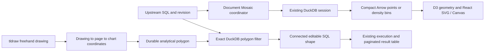

# Native visualization prototype

This is an opt-in scatterplot prototype, not an ECharts migration. The analytical selection and backend integration have been exercised without a browser. Browser interaction, visual appearance, Canvas paint time, and browser memory have **not** been verified, following the instruction not to view Chromium/the app. The browser fixture is supplied for later use; it is not a completed acceptance test.

The main result is independent of rendering: a million-row input reduced to 1,890 density bins produces an ordinary SQL query selecting exactly 128,010 source observations. Bidirectional `EXCEPT ALL` against an independent integer predicate returns zero differences, including multiplicity. The result is executed through the existing CLI query-result view and its last ten rows can be retrieved through existing pagination.

## Trying the implemented flow

1. Run a DuckDB SQL shape with two numeric columns. For example:

   ```sql
   SELECT i AS id,
          (i % 1000)::DOUBLE / 1000 AS x,
          (floor(i / 1000) % 100)::DOUBLE / 100 AS y
   FROM range(1000000) AS t(i)
   ```

2. Create an ordinary scatter chart, choose `x` and `y`, then choose **Try native scatter + lasso to SQL**.
3. Choose **Draw lasso**, or use tldraw's draw tool. Start inside the plot and close the outline. The top chart under the first drawing point handles completion. **Use drawing / retry** can explicitly apply a selected drawing.
4. The local preview highlights immediately after drawing completion. **Explore selected data** enables after DuckDB returns a count, including when that count is zero.
5. Exploring creates and executes a connected SQL shape and its normal result table. The source query, chart and original drawing remain. The **ECharts** button returns to the existing renderer.

The prototype supports numeric linear and positive-log axes, SVG or Canvas marks, full-data density bins, and a single visual series. Existing color grouping is retained in the old spec but explicitly labelled as unapplied in native mode. Temporal/categorical scatter axes, hover tooltips, export, domain zoom controls, production bar/line interactions and styling parity remain future work.

## A. Current implementation, traced in code

### Canvas and charts

[`ChartUtil.tsx`](../../app/Chart/ChartUtil.tsx) registers `chart-shape`. Its persisted props hold `sourceShapeId`, chart type, x/y/color fields, y-axis policy, stacking, limit, size and name. ECharts options are generated from those props, not persisted as marks. Chart children can contain tldraw drawings, annotations and images; analytical shapes cannot be nested as children.

The existing chart reads upstream SQL metadata, calls `useQueryResultRows`, retrieves at most 10,000 rows and uses `buildChartOption`. It chooses SVG below 1,000 rows and Canvas otherwise, and adjusts Canvas DPR for tldraw zoom. The cap is a prefix of results, not a statistical sample. Existing tables use backend pages; they are not capped to the chart limit.

**Discrepancy:** `ChartActionBar.tsx` currently offers **scatter, line, bar and area**, not thin line. Area is a line series with area style. No old `area` chart is reinterpreted or removed. Thin line is introduced only as a shared rendering primitive in this experiment.

The prototype keeps `chart-shape` and its validators/migration sequence. Optional `meta.nativeVisualization` enables it only for scatter. Shape props still open in old code. Native configuration and analytical intent live in optional metadata; no separate chart shape type or thousands of tldraw marks are introduced.

### SQL and result transport

[`walkSQLDag.ts`](../../app/SQLTextArea/walkSQLDag.ts) discovers named canvas dependencies, resolves knobs, chooses native/federated execution and builds nested SQL CTEs. Arrows express lineage, but SQL references determine execution dependencies. [`executeSQLShape.ts`](../../app/SQLTextArea/executeSQLShape.ts) creates/updates connections, dispatches run events, records schema/count/timing/errors and creates a result-table shape. The native branch uses this function unchanged.

[`LocalServerProvider.tsx`](../../app/client/localServer/LocalServerProvider.tsx) sends SQL to `POST /api/session/queries`. [`Session.RunQuery`](../../cli/internal/session/session.go) prepares SQL and creates a DuckDB view named from the result shape ID, then returns schema/count. These views are **live**, not frozen result snapshots. `GET /api/session/queries/{shapeId}/rows` returns Arrow pages. Tables retain that path, including sorting and exports. Chart/table restoration normally recreates missing views; automatic BigQuery restoration is deliberately restricted.

`POST /api/session/compute` already executes a SELECT in the **same document session**, via `Session.Compute → Engine.Query → rowsToArrow → writeArrowResult`. It carries request cancellation into DuckDB. The new Mosaic connector uses this endpoint through `backendRequest`/`sessionFetch`, retaining the canvas URL, credentials, editor token, document ID and backend activity accounting. No second application database or Mosaic server is introduced.

The older [`runner.Execute`](../../cli/internal/runner/runner.go) transport can encode Arrow and fall back to compressed Parquet, with hosted result limits/truncation. It is distinct from the current app's live-view/page workflow. The visualization connector requests compact Arrow directly from compute and rejects a non-Arrow response. It never decodes Parquet as Arrow, truncates a lasso result, or routes the authoritative selection through a chart preview. Existing Parquet uploads/exports and old transfer code are unchanged.

### DuckDB, external sources and the browser

`Engine` owns the native DuckDB database and a pool capped at five connections. Source adapters attach configured catalogs; uploads are document-owned native tables in `uploaded_files`. Startup configures allowed filesystem paths and locks configuration. Session closure cancels auxiliary operations; the document gate prevents cross-document requests.

**There is no active application DuckDB-WASM instance in this checkout.** `app/src/duckdb` contains SQL/type helpers, not a browser database lifecycle. `@duckdb/duckdb-wasm` is present transitively through installed Mosaic. The browser application is a frontend for the CLI, so there is no current browser connection to reuse in production.

All these app paths enter DuckDB, but it is not the universal **analytical** execution engine: single-source PostgreSQL/BigQuery queries are translated to their native dialect and embedded in `postgres_query`/`bigquery_query` table functions. DuckDB is the entry point; the remote engine executes the embedded analysis. Federated queries execute outer SQL in DuckDB over attached/deferred sources. This is the precise qualification to the universal-DuckDB assumption.

The prototype conservatively rejects PostgreSQL/BigQuery dependencies and native query functions, plus unknown or unsupported qualified catalogs. It supports known DuckDB/file/directory sources. This is a prototype eligibility check, not a SQL security boundary; the existing backend remains responsible for access control.

For production, give every chart a DuckDB-addressable relation with explicit provenance: an attached relation, a bounded native-result import, or an explicitly approved cached query result. Apply visualization grouping, domain filters and polygon predicates in DuckDB over that relation. Native remote SQL can remain an upstream pushdown optimization. Do not translate the polygon predicate into a remote dialect or automatically import an enormous remote source. Track source revision and materialization budget server-side, and surface BigQuery cost/refresh decisions.

### Documents

[`document.go`](../../cli/internal/localapp/document.go) writes format 2 archives and accepts format 1. Uploaded originals remain archive blobs and rebuild native tables; cached result views are disposable. Canvas schema migrations and recoverable parsing remain in place. No archive format, pinned tldraw version, or chart migration ID changed. A test extracts charts from the bundled Titanic `.kavla` file, migrates/validates them with the existing chart schema, and round-trips additive native metadata without changing props. This is chart-record compatibility coverage, not a visual regression test of the whole document.

## B. Mosaic assessment

**Recommendation: retain Mosaic Core directly, with the small transport/lifecycle adapter in this prototype.** The installed version is **0.33.0**. No vgplot or Observable Plot rendering was added. Recommendations below come from installed source inspection and executable tests, not only current website documentation.

| Capability | Finding and prototype behavior |
| --- | --- |
| Arrow | Connector returns raw IPC bytes. Core decodes with Flechette, whose tables differ from `apache-arrow.Table`; consumers use `toArray()`/`numRows`. No decode/re-encode between backend and Mosaic. |
| Scheduling | Core has High/Normal/Low priorities and concurrent request management. Counts use High. Visible plot requests use Normal. Culled charts stop issuing new requests. Native DuckDB still limits actual connection concurrency. |
| Deduplication/cache | Installed manager shares in-flight promises and caches by **SQL string**, not arbitrary request options. Tests prove sharing and invalidation using revision-qualified SQL. Plot SQL includes source/encoding/refresh identity; bin SQL includes relevant dimensions. |
| Cancellation | In 0.33, `cancel()` rejects promises/removes queued work but does **not** abort connector execution. Current online docs describe AbortSignal/timeout support not present in this installed source. Tests demonstrate the discrepancy. |
| Thin cancellation adapter | Extra query options carry an explicit signal for uncached selection requests. It reaches fetch and the existing backend context. Session disposal aborts all transport requests. Obsolete cached/shared plot requests are logically cancelled but allowed to finish so one subscriber cannot abort another's work. |
| Scope | `VisualizationProvider` owns a coordinator per document/backend/editor authorization epoch, never `coordinator()`'s global singleton. Source-run completion invalidates the session cache. Cleanup also accommodates React StrictMode's effect replay. |
| Custom clients/selections | React uses `coordinator.query` directly. A separate executable test connects two arbitrary `MosaicClient`s to one `Selection`, applies the shared polygon predicate and verifies that both update. No plotting library is needed. |
| Consolidation | Structural consolidation requires Mosaic query ASTs; it cannot merge arbitrary polygon SQL strings meaningfully. 0.33 also queues work for a frame before consolidation, outside normal cancellation removal. Disabled for this slice; use ASTs and retest cancellation for compatible bar/line queries later. |
| Preaggregation | Installed `PreAggregator` optimizes supported aggregates with point/interval metadata, and issues schema/table DDL. Arbitrary polygon predicates are not interval metadata. The current compute endpoint is SELECT-only, so automatic preaggregation is explicitly disabled and `exec` fails clearly. |
| M4 | `@uwdata/mosaic-sql` exports `m4`; the follow-on line planner executes this actual implementation in DuckDB. It preserves first/last/min/max per bin/run. It does not by itself discover missing-data gaps. |

For shared React crossfilters, retain `MosaicClient`, `Selection`, `Param`, AST builders and Core's cache/queue. Keep durable selection definitions, row provenance, polygon semantics and SQL artifacts in Kavla. A polygon clause must not claim interval metadata to obtain an invalid preaggregation optimization. The prototype exposes `selectionPredicate` for custom clients using the same `observation` alias as generated SQL.

Before production adoption, add/refine abort ownership for shared in-flight work, explicit query timeouts, bounded concurrency aligned with backend capacity, and revision-aware materialization. These are narrow integration tasks; the evidence does not justify writing another coordinator.

### Browser connector path

`reuseBrowserConnection(connection)` requires an already-owned `AsyncDuckDBConnection` and uses `useUnsafe/runQuery` to receive IPC directly, matching the approach of Mosaic's `wasmConnector({ duckdb, connection })`. It never instantiates a database or closes the host connection. Cancellation discards obsolete replies; it deliberately does not interrupt an unrelated query sharing that connection. A future browser host must own scheduling and interruption isolation.

The WASM experiment creates a database **only in the test process**, then reuses its connection and a pre-existing table through Core. It uses the same raw IPC path in Node's blocking WASM runtime. It does not validate the async browser worker adapter or browser memory/CPU behavior.

## C. Analytical selection and rendering



The small declarative model uses existing chart type/source/x/y/color/style/size props plus optional native scale/renderer metadata. `Axis` defines field, scale type and numeric domain. `ScatterSelection` version 1 records source ID/revision/expanded SQL, chart/drawing IDs, axes, polygon, `observations` semantics and `live` policy. It is saved as JSON in metadata; the generated SQL is independently executable within the ordinary named-query DAG. Removing the drawing, selection metadata or caches does not remove SQL behavior.

`geometry.ts` shares D3 scales and projection/inversion between axes, marks, overlays and drawings. The drawing's full page transform is followed by the chart inverse transform and fixed plot offsets; tldraw camera zoom and device pixels do not enter SQL. Canvas uses device pixel ratio for raster resolution only. Plot geometry and ticks are recomputed on resize; marks/axes are memoized. Native resizing leaves original child annotation geometry unchanged and reprojects the analytical overlay. The original drawing is not silently rewritten to match an edited domain.

For small inputs, DuckDB returns all finite x/y observations. Above 10,000 valid observations it groups **every** source row into occupied scale-space bins, roughly eight chart pixels per bin, capped at 128×128. Rare occupied bins are retained; there is no random sampling. Bins can still hide distinctions within a dense cell, so analytical zoom and a future outlier overlay are useful next steps. If a live source grows past the point budget between requests, an overflow sentinel produces an error instead of silently sampling it. Domain/count statistics and plot queries are separate scans, not one source snapshot.

### Exact means a specified numeric polygon, not a box

The predicate first rejects null/nonfinite coordinates, transforms observations into normalized linear/log scale space, clips to the selected domain, and applies a bounding box **prefilter followed by** a complete even-odd edge test. Boundary points are included using a documented tolerance of `1e-12` in normalized coordinates. This finite-precision policy is shared with immediate feedback. Casting to DOUBLE matches the visual coordinate representation; high-precision integers/decimals can share visual coordinates, and all matching rows are retained.

For log axes, DuckDB transforms each observation using `ln` before the polygon test. Inverting only polygon vertices to raw values would produce the wrong curved-edge region and is not used. Reversed domains are supported by the geometry and predicate, even though reversal/domain-zoom controls are not yet exposed in the prototype UI.

Adjacent duplicate vertices are removed. Self intersections have explicit even-odd semantics. Incomplete paths must finish within 12 chart-local pixels of their starting point or be marked closed by tldraw; closing adds the final straight segment. Collinear/degenerate paths, nonfinite coordinates and paths over 512 vertices fail with a specific error. No polygon simplification or bounding-box approximation is substituted. A very thin polygon can be rejected below the numeric area tolerance. Valid polygons selecting zero or one observation produce normal SQL. Duplicate coordinates preserve row multiplicity.

The analytical outline follows the drawing's recorded centerline vertices, not the pressure-dependent outer stroke or tldraw's smoothed ink contour. The chart overlay shows that polygon explicitly. Moving or editing the drawing after accepting it does not silently change an existing selection; use **Use drawing / retry** to accept the revised outline.

Displayed points highlight after drawing completion, without waiting for DuckDB. Density highlights are explicitly labelled as a **bin-center preview**, not a selected-row count. Only an uncached DuckDB count enables exploration. Source/encoding changes invalidate selection applicability; stale async replies are ignored. Failures retain the drawing and metadata/error association for retry. The branch is marked dirty if the upstream definition changes during execution.

### Live predicates and aggregate lineage

Live is the default: the polygon and its original axes are fixed, but source rows can change. Counts and later SQL executions can therefore differ. Refresh explicitly re-queries the plot; out-of-band source mutations are not automatically detected. A production source revision service and snapshot option would be needed to promise frozen row sets. Snapshot selection requires stable keys and persisted source data/version, not visible row IDs or temporary tables.

| Chart | Proposed selection contract | Current implementation |
| --- | --- | --- |
| Scatter | Select all upstream observations whose plotted coordinate centers lie inside the polygon, including duplicate coordinates. If upstream SQL is aggregated, these are upstream aggregate rows, not automatic contributor drilldown. | Implemented and SQL-tested. |
| Line / thin line | Select source observations at their plotted coordinates. Crossing an interpolated segment alone selects nothing. Apply the predicate to the full pre-reduction source, not M4 vertices. | Shared D3 path/thin stroke and executable M4 planner; UI/selection wiring pending. |
| Bar | Gesture selects intersected bar marks; persist grouping keys with null-safe equality. Default branch selects plotted aggregate rows. An explicit “contributing rows” action uses grouping-key lineage and retains source filters. | Shared band/rectangle primitives and executable DuckDB grouping with overflow sentinel; UI/hit semantics pending. |

Line input must identify contiguous runs before M4; separate runs render as separate paths. A numeric/time x axis can be mapped to pixels, but duplicate timestamps, ordering, null gaps and per-series tie policy need integration before enabling line charts. High-cardinality bars must reject overflow or explicitly present top-k/Other with contributor lineage; never quietly discard categories.

### Spatial option

DuckDB's spatial extension supplies point/polygon predicates, including `ST_Covers`. It is a candidate for simple valid polygons in the **same transformed scale space**, with the same bounding prefilter. Its exact overload/boundary/invalid-polygon behavior must be tested before substituting it for the current rule. Self-intersecting freehand paths require deliberate normalization or the even-odd SQL fallback. The prototype does not install/load spatial or assume it exists offline. [DuckDB spatial reference](https://duckdb.org/docs/current/core_extensions/spatial/functions).

DuckDB documents spatial support in WASM, with extensions commonly downloaded on demand. Availability still depends on the particular engine build, platform and deployment network policy; this session did not validate extension loading in the installed runtime. The extension-free predicate already executes in both native DuckDB and WASM-in-Node. [DuckDB WASM extensions](https://duckdb.org/docs/current/clients/wasm/extensions).

## D. Measurements and correctness

See [benchmark results and reproduction](benchmarks.md), [raw CLI/SSR results](node-results.json), and [raw WASM-in-Node results](wasm-node-results.json). No library benchmark is presented as a Kavla browser result. The scripts use Kavla's actual planner, polygon compiler, CLI `Session`/Arrow paths, ECharts option builder and React SVG components.

## E. Cache ownership and migration

| Cache | Owner and recommendation |
| --- | --- |
| Source results | DuckDB, opt-in and budgeted. Existing result views are not materialized caches. Prefer a session-local native table for expensive repeated upstream work only when its refresh/permissions/cost policy permits it. Never automatically materialize a whole remote catalog. |
| Visualization data | Mosaic's bounded LRU, 32 MiB in the prototype. Scope the coordinator to document/auth/session; include source SQL/revision, scales, domain, filter and relevant bin dimensions in SQL identity. Counts bypass the cache. Revision changes replace the coordinator so late old requests cannot repopulate the active cache. Decoded React objects add memory beyond IPC accounting. |
| Render data | Memoized geometry/marks/axes; Canvas bitmap persists between unchanged props. Page pan/zoom does not change analytical queries; crossing visibility boundaries can cause a cache-backed refresh. The prototype has no additional frame-cache framework. |

Mosaic materialized preaggregations could cover many repeated bar/bin crossfilters after adding a controlled backend materialization API and revision-aware schema cleanup. Its manager cache alone is not an upstream source cache. Do not save temporary view names as analytical artifacts.

Recommended next steps:

1. Review/run the browser fixture only when browser work is authorized. Validate pointer capture, freehand completion, overlapping charts, nested/rotated drawings, resize, DPR and SQL-shape execution. Measure Canvas, paint/RAF latency, panning, 1/10/30 simultaneously visible shapes, cancellation and source-refresh races.
2. Add server-issued relation revisions and explicit native-remote-result materialization. Define cost/resource budgets and remove the prototype's conservative source restrictions only after that path is tested.
3. Improve query cancellation/timeout ownership against the installed Core implementation; benchmark differing simultaneous queries, not only identical shared requests. Add stable replay tests for session switches and editor ownership transfer.
4. Add domain zoom, outlier detail, temporal axes, hover and series styling. Make the native spec a versioned declarative object once these semantics are settled; preserve legacy props through an additive migration.
5. Integrate the tested M4/bar primitives and their explicit selection contracts. Retain `area` compatibility until there is an intentional equivalent.
6. Expand the opt-in cohort, then make native scatter the default for new supported charts only. Leave old ECharts shapes unchanged and keep a reversible conversion path. Remove ECharts only after browser performance, interaction parity and archive regressions pass.

GPU is not warranted by the current evidence: browser Canvas has not been measured, and density already bounds the number of marks. A future WebGL candidate is deck.gl's `ScatterplotLayer` or a small instanced-point renderer; it must consume the same geometry/coordinates and leave analytical selection in DuckDB. Benchmark upload overhead, context count and memory for 30 charts before adopting it. WebGPU is not a prerequisite. [deck.gl ScatterplotLayer](https://deck.gl/docs/api-reference/layers/scatterplot-layer).

Major remaining risks are unverified browser interaction, repeated full-source scans, source changes between statistics/plot/count, partial visual parity, long polygons, coarse density bins hiding within-bin anomalies, remote-dialect/materialization semantics and Core 0.33 physical cancellation. The current measurements support continuing the prototype, not replacing ECharts wholesale.

## Research references

The live documentation can describe features newer than the installed 0.33.0 source; installed source/tests take precedence for the findings above.

- [Mosaic repository](https://github.com/uwdata/mosaic) and [Core overview](https://idl.uw.edu/mosaic/core/).
- [Coordinator API](https://idl.uw.edu/mosaic/api/core/coordinator.html): query coordination and lifecycle.
- [Connector API](https://idl.uw.edu/mosaic/api/core/connectors.html): raw IPC connector contract.
- [Custom client API](https://idl.uw.edu/mosaic/api/core/client.html) and [web framework clients](https://idl.uw.edu/mosaic/web-clients/): arbitrary React integration.
- [Mosaic SQL queries](https://idl.uw.edu/mosaic/api/sql/queries.html): AST builders; installed `src/transforms/m4.ts` supplies the tested reduction implementation.
- [D3 scales](https://d3js.org/d3-scale): projection, inverses and ticks used by Kavla's geometry.
